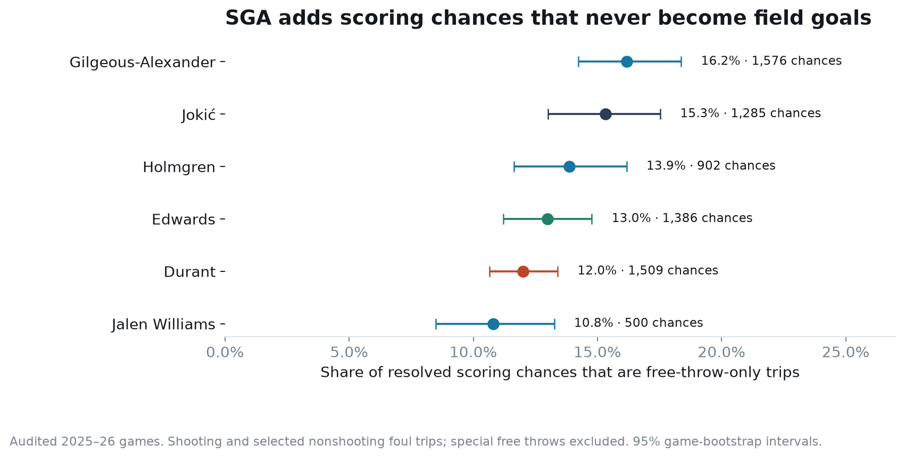
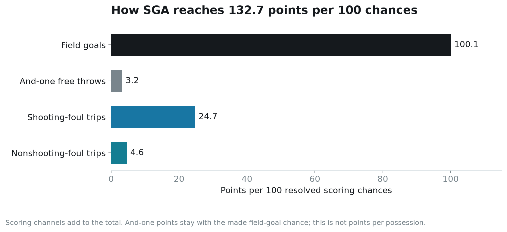
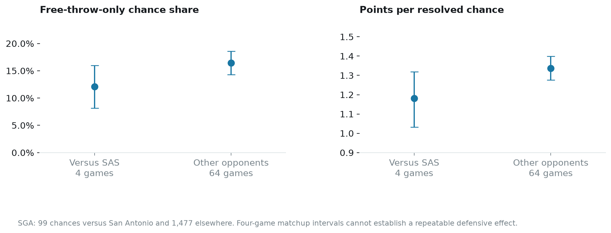

# The part of SGA’s offense a shot chart misses

Joseph Smarrelli · September 2026 · Oklahoma City scouting study

A field-goal-only report leaves out a substantial part of Shai Gilgeous-Alexander’s scoring. In this audited 2025–26 sample, free throws supplied **24.6% of his retained points**. Another **16.2% of his resolved scoring chances** ended in a free-throw trip without a recorded field goal attempt.

For San Antonio’s preparation, the useful question is where those trips come from and how they change the defensive assignment. A lower field goal percentage is an incomplete success measure if the same approach sends the scorer to the line.

## Count the trip rather than applying a free-throw coefficient

I reconstructed ordinary free-throw trips from the event sequence. A trip must contain the full numbered set of attempts at the same game clock, identify the shooter and resolve to one preceding opposing foul. A made field goal followed by its single shooting-foul free throw remains one chance. A resolved two- or three-shot foul trip without a field goal becomes a separate chance.

The resulting denominator is **resolved scoring chances**, not possessions. It includes field goal attempts and supported shooting- or nonshooting-foul trips. Turnovers, technical free throws, clear-path and flagrant free throws, and unresolved trip sequences are outside this calculation. Nonshooting trips are classified from the foul record; the code does not reconstruct bonus status.

This method retains 582 of SGA’s 588 ordinary free-throw attempts in audited games. Five ordinary trip clusters cannot be resolved safely, and 26 special free throws are excluded separately. Related field goals are also removed when an ordinary trip at that clock is unresolved, so an uncertain and-one does not silently become a clean field-goal-only chance.

The sample contains **1,576 chances in 68 games**. It is a research sample with stated exclusions, not a replacement for his official season totals.

## Two different kinds of foul pressure

SGA has 213 retained shooting-foul trips with no field goal attempt and 42 retained nonshooting-foul trips. There are also 61 made-field-goal chances with an and-one free throw. These events place different demands on a defense.

For a shooting-foul trip, a review should locate the contact within the attack: the initial drive, a recovery step, the gather or the contest. A nonshooting trip requires a different review of the foul and the surrounding game state. Its label alone does not establish whether the defender was beaten, whether the contact was avoidable or whether the team was already in the penalty.

The comparison chart includes Holmgren and Jalen Williams, plus Jokić, Edwards and Durant as other Western Conference scoring profiles. SGA’s free-throw-only share is 16.2%; Jokić’s is 15.3%. Their uncertainty ranges overlap. The chart describes different scoring samples and should not be read as an adjusted ranking of foul-drawing skill.

## Where the points come from

SGA’s retained chances produce **132.7 points per 100 chances**. Field goals supply 100.1, and-one free throws 3.2, shooting-foul trips 24.7 and nonshooting-foul trips 4.6, before rounding. Those components add to the total.

The free-throw contribution is large enough to warrant a separate section of an opponent report. It does not establish a points saving from avoiding a particular foul. A different contest might allow a basket, a pass or another attack, and those alternatives are not observed here.

## What the Spurs sample can and cannot say

In four games against San Antonio, SGA has 99 resolved chances. His free-throw-only share is **12.1%**, compared with **16.5%** against other opponents. Points per resolved chance are **1.18** against the Spurs and **1.34** elsewhere.

Four games are too few to establish a repeatable defensive effect. The comparison also mixes lineups, availability, pace and situations. Bootstrap intervals recycle those four games; they cannot supply the matchup variation that is absent from the sample. The broader shot-location project has five Spurs–Thunder games, but only four contain SGA chances in this study.

## Turn the report into a film request

The delivered review queue identifies 15 early chronological SGA foul-only trips. It is a set of examples to locate, not completed film coding or a representative sample. For a full review, include both shooting and nonshooting trips, along with similar attacks that end without a whistle.

Tag the action, primary defender, help timing, contact point and available pass. Pair the resulting foul information with field-goal quality and turnovers from the same action family. That would let a staff evaluate the whole defensive tradeoff instead of treating fewer whistles as the only objective.

These are historical opponent profiles. A future playoff plan still needs current personnel, coverage and availability information. The project supplies the scoring accounting and a way to audit the events behind it.

## Data and reproduction

Source: NBA events and shot records in the [pinned public archive](https://github.com/shufinskiy/nba_data/tree/e829d4678be1e075f99e5d41a1c5f97089be446b). The shared event audit retains 1,212 of 1,230 league games. The repository includes trip-level exclusions, scoring chances, SQL summaries and an executed notebook. Intervals use 2,000 game resamples.
