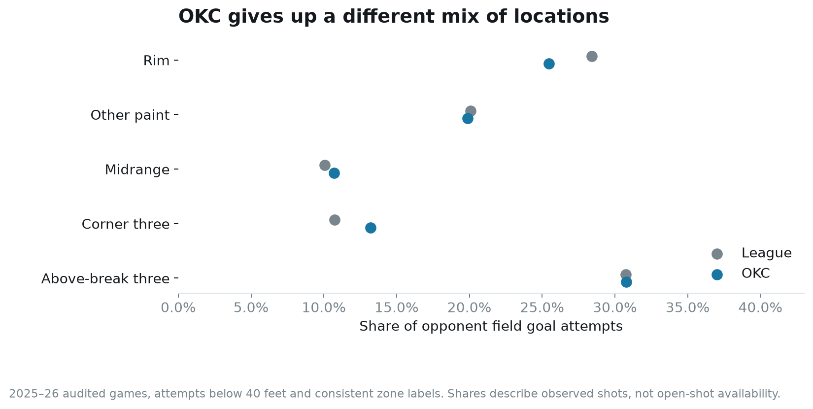
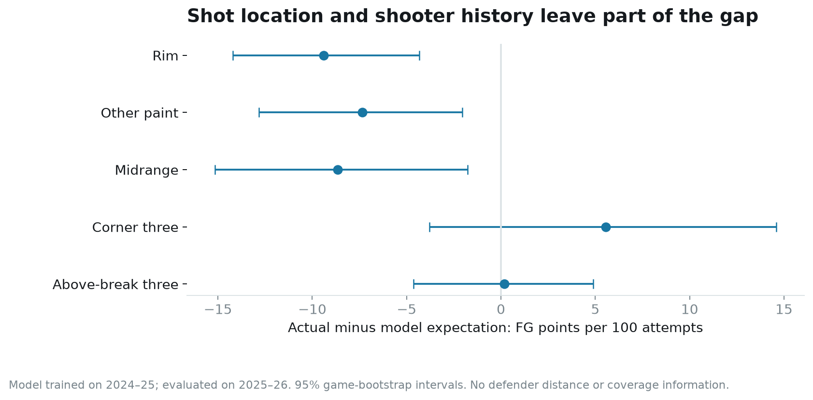
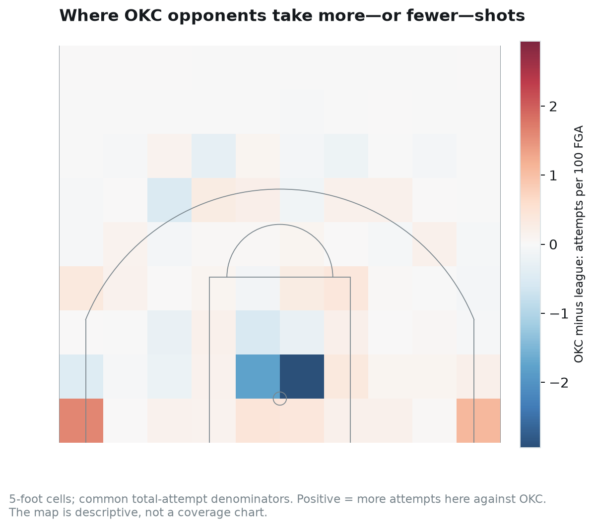

# The shots Oklahoma City allows

Joseph Smarrelli · September 2026 · Thunder opponent scouting

Oklahoma City’s opponents took a larger share of their field goal attempts from the corners and a smaller share at the rim than the league overall. The corner difference is a useful place to begin an offensive review. It does not establish that an open corner three is available on demand.

The second part of the study asks whether location and shooter history explain the scoring on those attempts. A model trained on the previous season still overpredicts opponent field-goal production against OKC by about **4.0 points per 100 attempts**. The larger negative gaps are inside the arc.

## Start with the shot distribution

The sample contains **7,244 opponent attempts across all 82 Thunder regular-season games**. Attempts from 40 feet or farther and inconsistent zone/value labels are excluded. Current-season evaluation games pass the shared event and scoring audit.

Corner threes account for **13.2%** of attempts against OKC, compared with **10.7%** across the evaluated league. Restricted-area attempts account for **25.5%**, compared with **28.4%**. Above-the-break three-point shares are similar; the difference is not simply that opponents take more of every kind of three.

For Spurs preparation, the next question is how the corner attempts arise. Are they the result of a paint touch, a skip pass, a second-side action or an offensive rebound? The public location record cannot answer that. It also cannot distinguish an early open catch from a late-clock release under a closeout.

## A model with a separate season for evaluation

I trained a gradient-boosted make-probability model on **218,905 attempts from 2024–25**. Inputs are shot distance, court coordinates, two- versus three-point value and a smoothed prior make rate for that shooter’s twos or threes. Training priors use 2023–24; evaluation priors use 2024–25. Each prediction therefore uses shooter history available before the evaluated season.

The 2025–26 evaluation includes **215,859 attempts in 1,212 audited games**. The model’s log loss is **0.6486**, compared with **0.6570** for the previous season’s broad zone-rate baseline. Lower is better. The paired difference has a 95% game-bootstrap interval of **−0.0091 to −0.0077**.

That improvement supports using the model as a more informative public-data reference than broad zones alone. It does not turn its output into a complete measure of shot quality. Defender distance, contest type, passing sequence and actual shot-clock time are missing.

## Where observed scoring differs from the reference

Against OKC, opponents score **1.037 field-goal points per attempt**, while the model expects **1.077**. The difference is −4.0 points per 100 attempts, with a 95% interval from −6.7 to −1.3. League-wide, the same model slightly underpredicts scoring, by about 0.5 points per 100 attempts.

The zone estimates are more specific:

| Location | Actual minus expected FG points per 100 attempts | 95% interval |
| --- | ---: | ---: |
| Rim | −9.4 | −14.2 to −4.3 |
| Other paint | −7.4 | −12.8 to −2.0 |
| Midrange | −8.6 | −15.2 to −1.8 |
| Corner three | +5.6 | −3.8 to +14.6 |
| Above-break three | +0.2 | −4.6 to +4.9 |

The corner estimate is uncertain and does not establish an extra conversion advantage. The inside-the-arc gaps are more consistently negative in this sample. They may reflect contest conditions, opponent selection, shooter changes or other features the model does not observe. They should not be assigned wholly to a defender or coverage.

## Locate the difference on the court

The map compares attempts per 100 field goal attempts in common five-foot cells. Red cells contain a larger share against OKC; blue cells contain a smaller share. Each sample uses its full eligible-attempt denominator. The picture describes where recorded shots occurred, not where defenders stood. Individual cell differences are exploratory and do not carry separate significance claims.

San Antonio has 444 eligible attempts against OKC in five regular-season games. The repository includes its zone split and 15 chronological corner-three examples from those games. Those identifiers can anchor a review of the action before the shot; they are not a substitute for watching the possession.

## A scouting conclusion with a clear limit

The corner distribution deserves attention in a Spurs offensive preparation session. A useful review would trace the action that produced each catch, identify the closeout and compare the passing risk with the alternatives inside the arc. It should also include possessions that tried to reach the corner and failed.

The current evidence cannot support a blanket instruction to trade every paint attempt for a corner three. Such a change would alter shooter selection, turnovers and the defense’s response. Those effects are outside this shot-conditioned model. Historical Thunder rotations also need an offseason refresh before the findings become a current matchup plan.

## Data and reproduction

Source: the [versioned public NBA archive](https://github.com/shufinskiy/nba_data/tree/e829d4678be1e075f99e5d41a1c5f97089be446b). The repository includes the model specification, frozen evaluation probabilities, calibration table, contender shot records, spatial cells, SQL and an executed notebook. Intervals resample games 2,000 times and condition on the fitted historical model.
