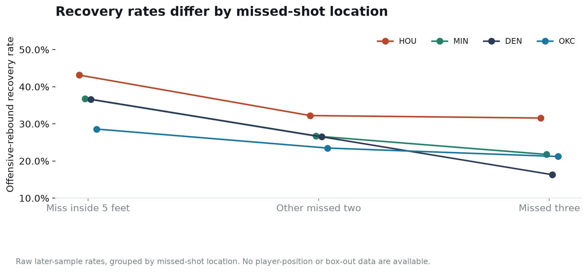
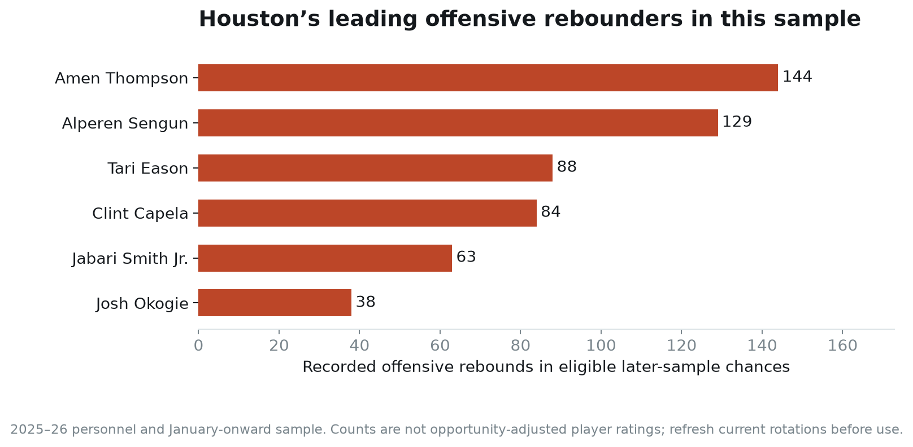

# The rebounding plan should change with the opponent

Joseph Smarrelli · September 2026 · Oklahoma City, Denver, Houston and Minnesota

Houston creates the clearest offensive-rebounding concern in this four-team comparison. From January onward, the Rockets recover **34.1% of eligible live rebound chances**, compared with 23.4% for both Oklahoma City and Denver and 26.3% for Minnesota.

The difference survives a model that accounts for where and when the missed shot occurred. Houston’s recovery is **7.6 percentage points above that reference, relative to the later league**, with a 95% interval from +5.6 to +9.6. That supports a different preparation emphasis from the one suggested by OKC’s historical rebound profile.

## Define a rebound chance before calculating a rate

For each recorded missed field goal, I find the next relevant event. A chance is retained only when that event is a recognized player rebound within eight game-clock seconds, with no intervening shot, foul, free throw, turnover, jump ball or period boundary. Team rebounds and unresolved records are excluded.

This produces **100,211 chances** from the audited league games, about 87.8% of the missed-shot records considered. The denominator is deliberately narrower than all missed shots. It does not reproduce the NBA’s official offensive-rebound percentage, and it excludes foul-only or dead-ball resolutions that may still have basketball value.

The recovery indicator is one when the rebounding player’s team matches the shooting team. A repeated miss and offensive rebound can create another chance in the same possession. That is valid for a rebound-chance rate, but these rows should not be relabeled as independent possessions.

## Account for the missed shot

A short miss and a long three do not present the same recovery opportunity. I fitted a gradient-boosted model to **40,553 pre-January chances**, using shot distance, coordinates, two- versus three-point value, period and remaining period time. Team identity and rebounder identity are excluded from its inputs.

The model is evaluated on **59,658 later chances**. Its log loss is **0.5740**, versus **0.5793** for the early league recovery-rate baseline. The paired difference’s 95% interval is −0.0062 to −0.0044. The improvement supports the relevance of the observed shot context; it does not account for player positions, box-outs, personnel or opponent strength.

For each team, I compare actual recovery with its predicted rate, then subtract the same residual for the later league. This centers the descriptive comparison on the model’s league-wide calibration error. It does not refit the model or improve its recorded prediction score using later outcomes.

| Offense | Later chances | Offensive rebounds | Raw recovery | League-relative model residual |
| --- | ---: | ---: | ---: | ---: |
| Houston | 2,048 | 698 | 34.1% | +7.6 pp |
| Minnesota | 1,919 | 504 | 26.3% | −0.3 pp |
| Oklahoma City | 1,982 | 463 | 23.4% | −2.9 pp |
| Denver | 1,941 | 455 | 23.4% | −3.0 pp |

Oklahoma City and Denver have negative residuals in this sample. That does not mean their players cannot punish a missed box-out. It says their observed retrieval rate is lower than this limited-context reference, relative to the league, over the chosen period.

## The location split changes the review

Houston’s higher recovery is visible after missed threes as well as shorter attempts. This gives the Spurs a reason to review perimeter rebounding responsibilities alongside the primary big-man matchup. The chart shows raw later-sample rates within broad location groups, so it still mixes player combinations and defensive opponents.

A staff review should identify who is responsible for making first contact, who retrieves the ball and who protects the outlet. The data here record only the eventual rebounder. They do not establish who won a box-out, created space for a teammate or failed an assignment.

## Which Houston sequences should be watched first?

Amen Thompson accounts for 144 of Houston’s retained later-sample offensive rebounds, Alperen Sengun 129, Tari Eason 88 and Clint Capela 84. These are counts from historical rotations, not opportunity-adjusted player ratings. Shared minutes, missed-shot volume and rebound responsibilities differ.

The repository includes missed-shot and rebound-event identifiers for the selected teams’ later games against San Antonio. Review successful offensive rebounds alongside defensive recoveries from comparable locations. Tag the initial matchup, help rotation, contact before the rebound, ball location and outlet position. That would separate the recovery result from the actions that made it possible.

## Carry the difference into preparation carefully

Houston’s result supports giving its rebounding sequences a distinct place in the opponent review. OKC preparation should still account for its specific crashers, even though its team recovery profile is lower. Denver and Minnesota require their own personnel checks rather than inheriting either opponent’s plan.

The study does not measure the transition cost of sending additional Spurs players to rebound, the number of players each opponent sends to the glass or the value of a different box-out assignment. It also does not forecast a playoff bracket. The figures provide completed-season benchmarks that need to be updated for current rotations and matchup availability.

## Data and reproduction

Source: NBA events and shot locations in the [pinned public archive](https://github.com/shufinskiy/nba_data/tree/e829d4678be1e075f99e5d41a1c5f97089be446b). The shared audit retains 1,212 league games. Event-level rebound exclusions, model specifications, later predictions, SQL summaries and an executed notebook are included. Uncertainty resamples entire games 2,000 times, including both the team and league terms of the comparison.
